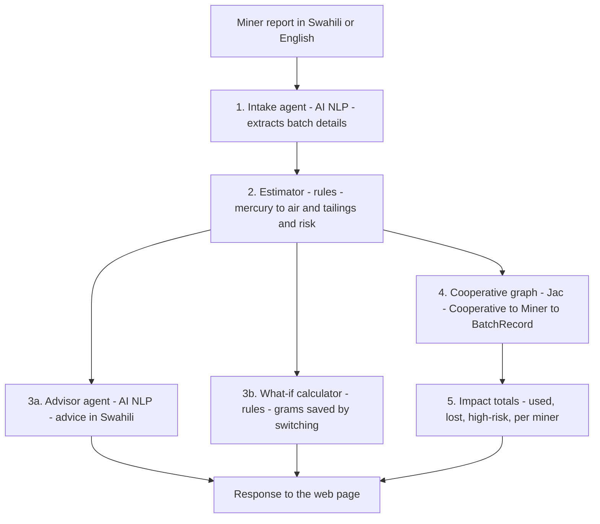

# Zebaki 🌍

**Zebaki** (Swahili for *mercury*) is a prototype multi-agent tool that helps artisanal and small-scale gold miners (ASGM), and the cooperatives that support them, estimate how much mercury each batch releases to air and to tailings. A miner describes a batch in Swahili or English. The agents turn that into an estimate, a risk rating, advice and a "what if" saving, and add the batch to the cooperative's totals on a dashboard with a printable summary report.

Built for the Green Shift Hacks hackathon (HackathonForEveryone, Devpost).

**Live demo:** [https://your-service-name.onrender.com/static/index.html](https://your-service-name.onrender.com/static/index.html) *(replace with your link once deployed)*

**Demo video:** *(add link)*

## The problem

Artisanal gold miners use mercury to capture gold from ore. Much of it is lost to tailings and soil, and much of the rest is released to the air when the amalgam is burned in the open. Most miners have no simple way to know how much mercury they lose per batch, or what a cleaner method would save.

## Who it is for

- **Miners and mining cooperatives**, who want to see their losses and compare methods.
- **Environmental programme officers and NGOs**, who track cooperative-level progress.

## How it works

Every batch follows the same path through the system:



| Component | Type | Role |
|---|---|---|
| Intake agent | AI (NLP) | Reads the message and returns ore weight, mercury used, amalgamation method and burning method. Unclear details are marked `UNKNOWN`, never guessed. |
| Estimator | Rules | Applies loss factors to estimate mercury released to air and left in tailings, and assigns a risk rating (HIGH, MEDIUM or LOW). |
| Advisor agent | AI (NLP) | Writes two or three sentences in Swahili explaining the result and suggesting one practical step. |
| What-if calculator | Rules | Estimates the grams that switching to concentrate + retort would save. |
| Cooperative graph | Jac graph | Links each batch to its miner and cooperative, so totals always add up. |
| Impact totals | Jac | Adds up the cooperative totals and the totals for each miner. |

**Design choice:** AI is used only where language is involved. All loss calculations are rules-based, so every figure can be checked and cited.

**Two ways to run it:** the command-line demo (`zebaki.jac`) walks the graph with a Jac walker to produce the totals, while the web version (`server.jac`) produces the same totals with a function. Both use the same estimator and graph.

## Features

- **English and Kiswahili.** English is the default. Choose Kiswahili from the dropdown to translate the labels, the dashboard, the table and the summary report. The advice is written in Swahili in both modes.
- **Record a batch.** Enter a miner name and a report, or use an example. The result card shows the risk rating, the grams used, the grams released to air and left in tailings, the switching saving, and the advice.
- **Cooperative dashboard.** Headline figures, a chart of losses by miner, and a table of miner details. High-risk batches are flagged in red.
- **Summary report.** A plain-language summary of the totals, with a button to print or save as PDF.
- **About.** Background, how the system works, and its limitations.

## Environmental benefit

Zebaki measures impact in **grams of mercury**:

- **Released to air:** from open burning, or from amalgam not captured by a retort.
- **Left in tailings:** left in soil and water, mainly from whole-ore amalgamation.
- **Could have saved:** the grams that switching to concentrate + retort would keep out of the air and tailings, shown for each batch.

## Limitations

- **The loss factors are illustrative assumptions.** The values in `server.jac` (for example 75% tailings loss for whole-ore amalgamation and 90% retort capture) are placeholders. They are not yet validated against field data or published measurements, and must be replaced with cited figures before any real use.
- **Estimates, not measurements.** Zebaki does not measure mercury in air, water or soil.
- **AI reads free text.** Unclear or incomplete messages may be misread. Missing details are marked `UNKNOWN`, treated as worst case, and flagged to the miner.
- **Advice is AI-generated.** It is not checked by the rules and should be reviewed before it is given to miners.
- **Not yet validated with miners or cooperatives.** Field testing is the next step.
- **"Avoided" is relative.** It compares with a worst case in which all mercury is lost.

## Run it locally

You need Python 3.12 or newer and an Anthropic API key.

1. Create a virtual environment and install the requirements:
   ```
   python -m venv venv
   venv\Scripts\activate          # Windows
   source venv/bin/activate       # macOS / Linux
   pip install -r requirements.txt
   ```
2. Set your API key. **Never commit it to the repository.**
   ```
   $env:ANTHROPIC_API_KEY="your-key-here"       # Windows PowerShell
   export ANTHROPIC_API_KEY=your-key-here       # macOS / Linux
   ```
3. Start the web version, then open `http://localhost:8000/static/index.html`:
   ```
   jac start server.jac --no_client
   ```

To run the command-line demo instead, use `jac run zebaki.jac`.

## Project files

- `zebaki.jac`: command-line demo of the full flow
- `server.jac`: the agents, estimator, graph, totals and web endpoints
- `assets/index.html`: the web page (dashboard, language switch, summary report)
- `requirements.txt`: pinned versions tested with this project
- `jac.toml`: project configuration (the admin portal is disabled)

## Web endpoints

| Endpoint | What it does |
|---|---|
| `POST /walker/analyse_batch` | Body: `{"miner": "Juma", "message": "..."}`. Returns the batch, estimate, advice, what-if saving and cooperative totals, including totals per miner. |
| `POST /walker/get_impact` | Returns the cooperative totals, including totals per miner, without adding a batch. |
| `/static/index.html` | The web page that calls the two endpoints above. |

## Tools used

- **Jac** (jaclang) for the agents, graph and web server
- **byLLM** for the AI calls
- **Claude** (Anthropic API) for the Intake and Advisor agents
- **jac-scale** for serving the web page
- **Chart.js** (loaded from cdnjs) for the dashboard chart
- Plain HTML, CSS and JavaScript for the page

## Deployment

The web version runs with this start command on a hosting service such as Render:

```
jac start server.jac --port $PORT --no_client
```

Set `ANTHROPIC_API_KEY` in the service's environment settings, and set `PYTHON_VERSION` to `3.12.7`. The server needs more memory than the smallest free tier provides, so use a paid instance. Free instances also sleep when idle, so the first visit may take about a minute.

## Licence and data

Built during the hackathon. No real miner data is included. All sample batches are invented for demonstration, and the miner names (Juma, Amina) are fictional.