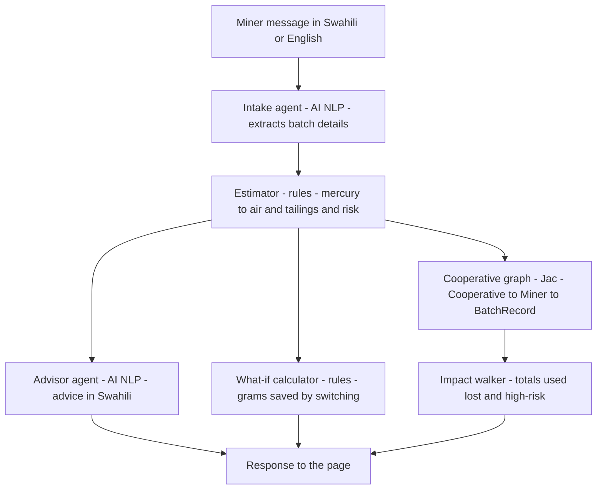

# Zebaki 🌍

**Mercury tracking and reduction for artisanal gold mining, powered by multi-agent AI.**

Zebaki (Swahili for *mercury*) helps artisanal and small-scale gold miners (ASGM) and their cooperatives estimate how much mercury each batch releases to air and to tailings. Miners describe a batch in Swahili or English. Zebaki returns a risk rating, plain-language advice and the mercury that a cleaner method would save, and adds each batch to the cooperative's running total.

Built for the Green Shift Hacks hackathon (HackathonForEveryone, Devpost).

**Live demo:** [https://your-service-name.onrender.com/static/index.html](https://your-service-name.onrender.com/static/index.html)
*The free hosting tier sleeps when idle. The first visit may take about a minute.*

---

## The problem

Artisanal gold mining is one of the largest sources of mercury pollution in the world. Miners use mercury to capture gold, and much of it is lost to tailings, soil and water. Much of the rest is released to the air when the amalgam is burned in the open. Most miners have no simple way to measure these losses or to compare them with cleaner methods.

## Who it is for

- **Miners and mining cooperatives**, who want to see their losses and identify cheaper, cleaner methods.
- **NGOs and programme staff**, who track progress across cooperatives.

## How it works

Each batch passes through four agents and a rules-based estimator:



| Component | Type | Role |
|---|---|---|
| Intake agent | AI (NLP) | Reads the message and returns ore weight, mercury used, amalgamation method and burning method. Unclear details are marked `UNKNOWN`, never guessed. |
| Estimator | Rules | Applies loss factors to estimate mercury lost to air and tailings, and assigns a risk rating (HIGH, MEDIUM or LOW). |
| Advisor agent | AI (NLP) | Writes two or three sentences in Swahili explaining the result and suggesting one practical step. |
| What-if calculator | Rules | Estimates the grams that switching to concentrate + retort would save. |
| Cooperative graph | Jac graph | Links each batch to its miner and cooperative. |
| Impact walker | Jac graph | Adds up the cooperative totals: mercury used, lost to air, lost to tailings and high-risk batches. |

**Design choice:** AI is used only where language is involved. All loss calculations are rules-based, so every figure can be checked and cited.

## Example

A miner reports: *"Nimetumia gramu 50 za zebaki kwa kilo 200 za mchanga mzima."*

| Result | Value |
|---|---|
| Mercury used | 50 g |
| Lost to air | 12.5 g |
| Lost to tailings | 37.5 g |
| Risk | HIGH |
| Saving if switched to concentrate + retort | 40.5 g |


| Endpoint | Method | Description |
|---|---|---|
| `/walker/analyse_batch` | POST | Body: `{"miner": "Juma", "message": "..."}`. Returns the batch, estimate, advice, what-if saving and cooperative totals. |
| `/walker/get_impact` | POST | Returns the cooperative totals. |
| `/static/index.html` | GET | The web interface. |


## Deployment

The app is deployed on Render with this start command:

```bash
jac start server.jac --port $PORT --no_client
```

Set `ANTHROPIC_API_KEY` in the Render environment settings.

## Project structure

```
zebaki/
├── server.jac          # Agents, estimator, graph and web endpoints
├── zebaki.jac          # Command-line demo
├── assets/index.html   # Web interface
├── jac.toml            # Project configuration
└── requirements.txt    # Pinned dependencies
```

## Limitations

- **Loss factors are prototype assumptions.** The values in `server.jac` (for example 75% tailings loss for whole-ore amalgamation and 90% retort capture) are placeholders. They must be verified against published ASGM guidance before any real use. Sources: *[add UNEP / Minamata Convention / Global Mercury Partnership references]*.
- **Estimates, not measurements.** Zebaki does not measure mercury in air, water or soil.
- **Free-text interpretation.** Unclear messages may be misread. Missing details are flagged to the miner and treated as worst case.
- **Not yet field-tested** with miners or cooperatives.
- **"Avoided" is relative.** It compares against a worst case in which all mercury is lost.

## Next steps

- Verify loss factors against published sources and replace the placeholders.
- Field-test with a cooperative and collect feedback from miners.
- Add SMS or WhatsApp access for miners without smartphones.
- Add cost and payback estimates for switching methods.

## Licence and data

Built during the hackathon. No real miner data is included. All sample batches are invented for demonstration.