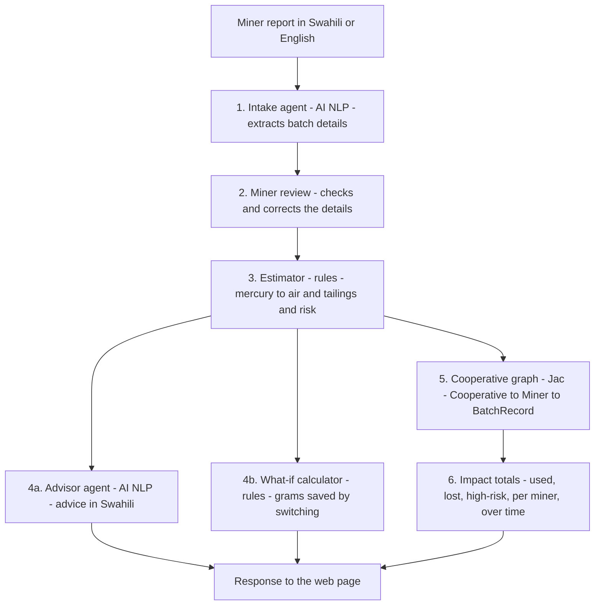

# Zebaki 🌍

**Zebaki** (Swahili for *mercury*) is a prototype multi-agent tool that helps artisanal and small-scale gold miners (ASGM), and the cooperatives that support them, estimate how much mercury each batch releases to air and leaves in tailings. A miner describes a batch in Swahili or English, checks the extracted details, and confirms it. The agents then estimate the losses, rate the risk, give advice and suggest a saving, and add the batch to the cooperative's totals on a dashboard with a printable summary report.

Built for the Green Shift Hacks hackathon (HackathonForEveryone, Devpost).

**Live demo:** not hosted for this submission. Run it locally with the steps in "Run it locally" below. It takes about five minutes.

**Demo video:** *(add link)*

## The problem

Artisanal gold miners use mercury to capture gold from ore. Much of it is lost to tailings and soil, and much of the rest is released to the air when the amalgam is burned in the open. Published estimates put the global share at about 59% to land and water and 41% to the atmosphere. Most miners have no simple way to know how much mercury they lose per batch, or what a cleaner method would save.

## Who it is for

- **Miners and mining cooperatives**, who want to see their losses and compare methods.
- **Environmental programme officers and NGOs**, who track cooperative-level progress.

## How it works

Every batch follows the same path through the system:



| Component | Type | Role |
|---|---|---|
| Intake agent | AI (NLP) | Reads the message and returns ore weight, mercury used, amalgamation method and burning method. Unclear details are marked `UNKNOWN`, never guessed. |
| Miner review | Person | The miner checks the extracted values and corrects any that are wrong. Nothing is saved until the miner confirms. |
| Estimator | Rules | Applies loss factors to estimate mercury released to air and left in tailings, and assigns a risk rating (HIGH, MEDIUM or LOW). |
| Advisor agent | AI (NLP) | Writes two or three sentences in Swahili explaining the result and suggesting one practical step. |
| What-if calculator | Rules | Estimates the grams that switching to concentrate + retort would save. |
| Cooperative graph | Jac graph | Links each batch to its miner and cooperative, so totals always add up. |
| Impact totals | Jac | Adds up the cooperative totals, the totals for each miner, and the batches over time. |

**Design choice:** AI is used only where language is involved. The miner confirms the extracted values before they are used. All loss calculations are rules-based, so every figure can be checked and cited.

**Two ways to run it:** the command-line demo (`zebaki.jac`) walks the graph with a Jac walker to produce the totals, while the web version (`server.jac`) produces the same totals with a function. Both use the same estimator and graph.

## Evidence labels

Every figure on the page carries one of these labels:

| Label | Meaning | Where it is used |
|---|---|---|
| **ESTIMATED** | Calculated from a published or illustrative factor for a retort or open-burning method. | Released to air. |
| **NOT VALIDATED** | Calculated from a placeholder with no source yet. Do not treat as a real figure. | Left in tailings. |
| **MODELLED** | A what-if scenario, not a measured outcome. | Switching savings. |

No figure in this prototype is marked MEASURED. A future version can add measured recovery values from retort operators.

## Worked example

A miner reports: *"Used 50g mercury on 200kg whole ore, burned in the open"*.

1. The intake agent reads 50 g, 200 kg, whole-ore amalgamation, and open burning.
2. The miner reviews the values and confirms them.
3. The estimator rates the batch **HIGH**. With the placeholder factors, 75% (37.5 g) goes to tailings and the remaining 12.5 g is released to air.
4. The what-if calculator switches the same batch to concentrate + retort. Tailings fall to 5 g and air to about 4.5 g. The saving is **40.5 g** (MODELLED).
5. Submitting the same report and mercury amount again is rejected, so the batch is not counted twice.
6. The batch is added to the cooperative totals and the dashboard updates.

## Features

- **English and Kiswahili.** English is the default. Choose Kiswahili from the dropdown to translate the labels, the dashboard, the table, the review step and the summary report. The advice is written in Swahili in both modes.
- **Review before saving.** The miner checks the extracted details, corrects any errors, and confirms before the batch is recorded.
- **Duplicate check.** An identical report from the same miner is not counted twice.
- **Cooperative dashboard.** Headline figures with evidence labels, a chart of losses by miner, a chart of losses over time, and a table of miner details. High-risk batches are flagged in red, and batches that need more information are counted.
- **Summary report.** A plain-language summary of the totals, the evidence status and how many batches have complete information, with a button to print or save as PDF.
- **About.** Background, how the system works, and its limitations.

## Environmental benefit

Zebaki measures impact in **grams of mercury**:

- **Released to air (ESTIMATED):** from open burning, or from amalgam not captured by a retort.
- **Left in tailings (NOT VALIDATED):** left in soil and water, mainly from whole-ore amalgamation.
- **Could have saved (MODELLED):** the grams that switching to concentrate + retort would keep out of the air and tailings, shown for each batch.

## Sources and calibration

The table below lists each numerical factor used, its value, its source and its status.

| Factor | Value used | Published figure | Source | Status |
|---|---|---|---|---|
| Retort capture | 90% | Good field retorts let about 5–20% of vapour escape (80–95% captured). Ecuador tests: 2.08–11.97% not recovered (88–98% recovered). | UNEP/Artisanal Gold Council practical retort guide; *Minerals* study on Nambija, Ecuador | ESTIMATED: within published ranges, but not measured for these conditions |
| Open burning | All mercury in amalgam goes to air | About 8.0 g released from about 16 g of amalgam during one measured burn | *Scientific Reports* study, Burkina Faso | ESTIMATED: supports high release, not a per-batch ratio |
| Tailings share, whole ore | 75% | No source gives a tailings-versus-air split for this method | None | NOT VALIDATED |
| Tailings share, concentrate | 10% | No source found | None | NOT VALIDATED |
| Global split of ASGM losses | Context only | 59.3% to land and water, 40.7% to the atmosphere | Springer, DOI [10.1007/s40831-021-00394-8](https://doi.org/10.1007/s40831-021-00394-8), citing AMAP/UNEP | Published, global, not used in the calculation |
| Whole-ore loss ratio | Context only | Up to 15 g Hg per g Au; global average 2.6 g per g | Same Springer article | Published, context only |

**Not sourced:** the Philippines (75%) and Mongolia (50%) figures are shares of national losses from whole-ore amalgamation. They are not the tailings factor used in the model.

**Studies are not controlled comparisons.** The Burkina Faso and Ecuador studies used different amalgam quantities and conditions, so they do not give a precise universal reduction. Treat the model's outputs as estimates.

## Limitations

- **The tailings factors are NOT VALIDATED.** They are placeholders with no source. They must be calibrated against field measurements before any real use.
- **Estimates, not measurements.** Zebaki does not measure mercury in air, water or soil.
- **AI reads free text.** Unclear or incomplete messages may be misread. The miner reviews the extracted values before they are saved, but the review is only as good as the miner's check.
- **Advice is AI-generated.** It is not checked by the rules and should be reviewed before it is given to miners.
- **Duplicate check is simple.** It rejects an identical report from the same miner with the same mercury amount. It does not detect other repeats.
- **Not yet validated with miners or cooperatives.** Field testing is the next step.
- **"Avoided" is relative.** It compares with a worst case in which all mercury is lost.

## Next steps

- Calibrate the tailings factors against field measurements from a cooperative.
- Add measured mercury recovery from retort operators, labelled MEASURED.
- Add reporting periods and compare them over time.
- Add follow-up questions to the intake agent when information is missing.

## Run it locally

You need Python 3.12 or newer and an Anthropic API key.

1. Create a virtual environment and install the requirements:
   ```
   python -m venv venv
   venv\Scripts\activate          # Windows
   source venv/bin/activate       # macOS / Linux
   pip install -r requirements.txt
   ```
2. Set your API key. **Never commit it to the repository.**
   ```
   $env:ANTHROPIC_API_KEY="your-key-here"       # Windows PowerShell
   export ANTHROPIC_API_KEY=your-key-here       # macOS / Linux
   ```
3. Start the web version, then open `http://localhost:8000/static/index.html`:
   ```
   jac start server.jac --no_client
   ```

To run the command-line demo instead, use `jac run zebaki.jac`.

## Project files

- `zebaki.jac`: command-line demo of the full flow
- `server.jac`: the agents, estimator, graph, totals and web endpoints
- `assets/index.html`: the web page (review step, dashboard, language switch, summary report)
- `requirements.txt`: pinned versions tested with this project
- `jac.toml`: project configuration (the admin portal is disabled)

## Web endpoints

| Endpoint | What it does |
|---|---|
| `POST /walker/preview_batch` | Body: `{"message": "..."}`. Extracts and estimates a batch without saving it. Returns the batch, estimate, advice and what-if saving. |
| `POST /walker/save_batch` | Body: `{"miner", "message", "ore_kg", "mercury_g", "amalgamation", "burning"}`. Saves the confirmed batch. Returns `saved` (true or false), the reason if not saved, and the cooperative totals. |
| `POST /walker/analyse_batch` | Body: `{"miner", "message"}`. Extracts, estimates and saves in one step, without review. Kept for compatibility. |
| `POST /walker/get_impact` | Returns the cooperative totals, totals per miner, and the batches over time, without adding a batch. |
| `/static/index.html` | The web page that calls the endpoints above. |

## Tools used

- **Jac** (jaclang) for the agents, graph and web server
- **byLLM** for the AI calls
- **Claude** (Anthropic API) for the Intake and Advisor agents
- **jac-scale** for serving the web page
- **Chart.js** (loaded from cdnjs) for the dashboard charts
- Plain HTML, CSS and JavaScript for the page

## Deployment

The web version runs with this start command on a hosting service such as Render:

```
jac start server.jac --port $PORT --no_client
```

Set `ANTHROPIC_API_KEY` in the service's environment settings, and set `PYTHON_VERSION` to `3.12.7`. Set `ZEBAKI_DEMO_CODE` to a code of your choice. Visitors are asked for this code before the page works, which stops strangers from using the AI key or adding batches. If the variable is not set, the code check is off (local testing only). The server needs more memory than the smallest free tier provides, so use a paid instance. Free instances also sleep when idle, so the first visit may take about a minute.

## Credits

Built with Jac and jac-scale (Jaseci), byLLM, the Claude API (Anthropic), and Chart.js. Figures and factors are taken from the sources in the table above; see the Limitations section for what is placeholder.

## Licence and data

Built during the hackathon. No real miner data is included. All sample batches are invented for demonstration, and the miner names (Juma, Amina) are fictional.
