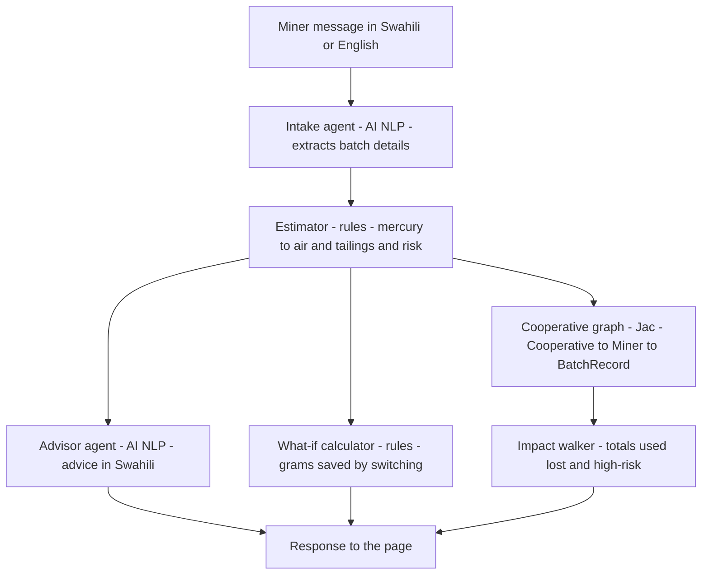

# Zebaki 🌍

**Zebaki** (Swahili for *mercury*) is a prototype multi-agent tool that helps artisanal and small-scale gold miners (ASGM), and the cooperatives that support them, see how much mercury each batch releases to air and to tailings. A miner describes a batch in Swahili or English. The agents turn that into an estimate, a risk rating, practical advice and a "what if" saving, and add the batch to the cooperative's running total.

Built for the Green Shift Hacks hackathon (HackathonForEveryone, Devpost).

## The problem

ASGM is one of the largest sources of mercury pollution in the world. Miners use mercury to capture gold from ore. Much of it is lost to tailings, soil and water, and much of the rest is released to the air when the amalgam is burned in the open. Most miners have no simple way to know how much mercury they lose per batch, or what a cleaner method would save.

## Who it is for

- **Miners and mining cooperatives**, who want to see their losses and find cheaper, cleaner methods.
- **NGOs and programme staff**, who track cooperative-level progress.

## How the agents work together

Every batch follows the same path through the system:



**Why it's split this way:** the AI is used only where language is involved, such as reading a messy Swahili sentence and writing advice. The loss calculations are rules, so the numbers can be checked and cited. The graph keeps every batch linked to its miner and cooperative, so totals always add up correctly.

**Command-line demo (`zebaki.jac`):** runs the same flow for four sample batches and prints each result, then the cooperative totals. It uses a separate Impact walker, which travels the graph, while the web version adds up the same records directly.

## Web endpoints

| Endpoint | What it does |
|---|---|
| `POST /walker/analyse_batch` | Body: `{"miner": "Juma", "message": "..."}`. Runs the full flow and returns the batch, estimate, advice, what-if saving and cooperative totals. |
| `POST /walker/get_impact` | Returns the cooperative totals without adding a batch. |
| `/static/index.html` | The web page that calls the two endpoints above. |

## Environmental benefit

Zebaki measures impact in **grams of mercury**:

- **Lost to air:** released from open burning, or from amalgam not captured by a retort.
- **Lost to tailings:** left in soil and water, mainly from whole-ore amalgamation.
- **Could have saved:** the grams that switching to concentrate + retort would keep out of the air and tailings, shown for each batch.

## Limitations

- **The loss factors are prototype assumptions.** The values in `server.jac` (for example 75% tailings loss for whole-ore amalgamation and 90% retort capture) are placeholders. They must be checked against published ASGM guidance before any real use. Sources: [add UNEP / Minamata / Global Mercury Project references here].
- **Estimates, not measurements.** Zebaki does not measure mercury in air, water or soil.
- **AI reads free text.** Unclear or incomplete messages may be misread. Missing details are marked `UNKNOWN`, treated as worst case, and flagged to the miner.
- **Not yet validated with miners or cooperatives.** Field testing is the next step.
- **"Avoided" is relative.** It compares with a worst case in which all mercury is lost.

## Tools used

- **Jac** (jaclang) for the agents, graph and web server
- **byLLM** for the AI calls
- **Claude** (Anthropic API) for the Intake and Advisor agents
- **jac-scale** for serving the web page
- Plain HTML, CSS and JavaScript for the page

## Run it locally

1. Install Python 3.12 or newer.
2. Create and activate a virtual environment:
   ```
   python -m venv venv
   venv\Scripts\activate          # Windows
   source venv/bin/activate       # macOS / Linux
   ```
3. Install the requirements:
   ```
   pip install -r requirements.txt
   ```
4. Set your API key. **Never commit it to the repository.**
   ```
   $env:ANTHROPIC_API_KEY="your-key-here"       # Windows PowerShell
   export ANTHROPIC_API_KEY=your-key-here       # macOS / Linux
   ```
5. Run the command-line demo (four sample batches):
   ```
   jac run zebaki.jac
   ```
6. Run the web version and open the page:
   ```
   jac start server.jac --no_client
   ```
   Then open `http://localhost:8000/static/index.html`.

## Project files

- `zebaki.jac`: command-line demo of the full flow
- `server.jac`: the agents, estimator, graph and web endpoints
- `assets/index.html`: the web page
- `requirements.txt`: pinned versions tested with this project
- `jac.toml`: project configuration (the admin portal is disabled)

## Deployment

Hosted on Render with the start command:
```
jac start server.jac --port $PORT --no_client
```
Set `ANTHROPIC_API_KEY` in Render's environment settings. The free tier sleeps when idle, so the first visit may take about a minute.

## Licence and data

Built during the hackathon. No real miner data is included. All sample batches are invented for demonstration.